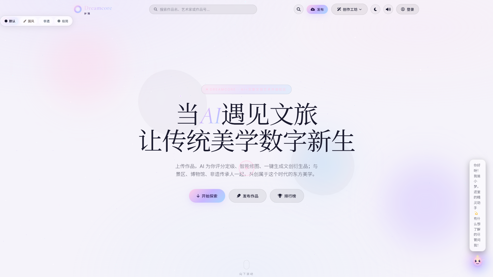
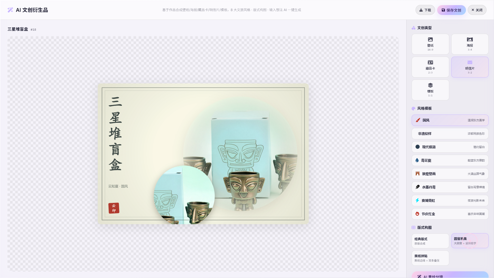
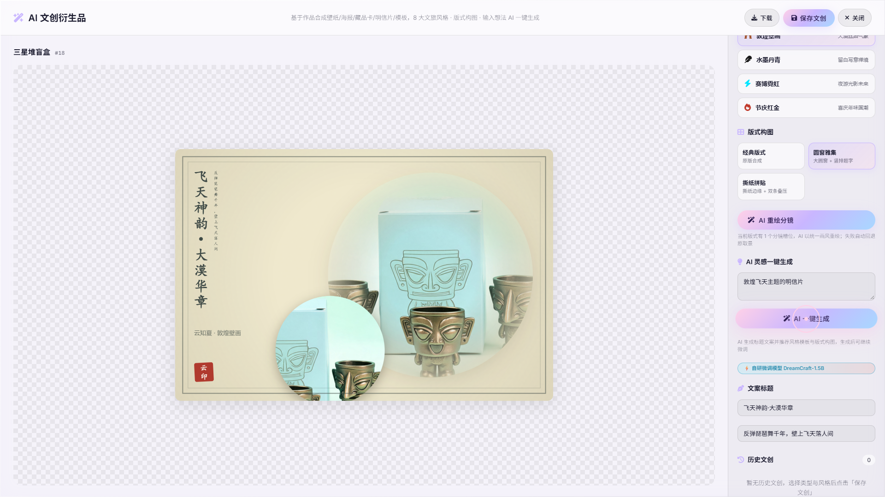
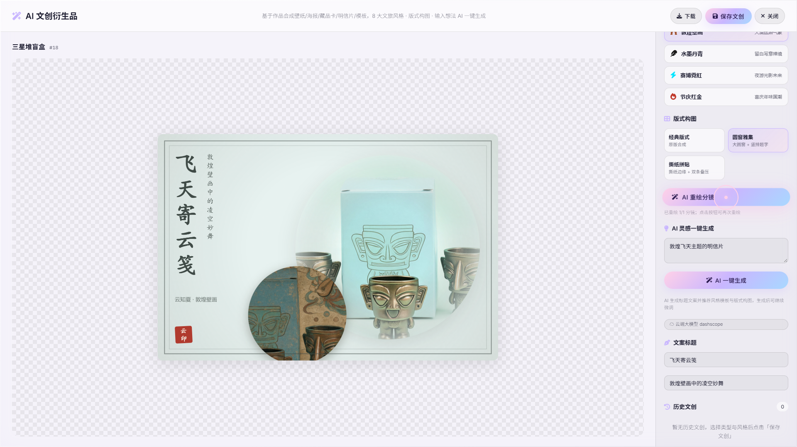

# Dreamcore · AI+文旅文创艺术共创社区

> 连接景区、博物馆、非遗传承人与数字创作者的 AI 文创共创平台——上传作品，AI 一键生成文创衍生品。

     

**当前版本：v1.0.0 · 2026-10（竞赛交付版）**

## 目录

- [项目简介](#项目简介)
- [效果展示](#效果展示)
- [核心功能](#核心功能)
- [技术亮点：领域微调模型全链路](#技术亮点领域微调模型全链路)
- [技术栈](#技术栈)
- [系统架构](#系统架构)
- [环境要求](#环境要求)
- [快速开始](#快速开始)
- [配置](#配置)
- [项目结构](#项目结构)
- [测试与质量保障](#测试与质量保障)
- [故障排查](#故障排查)
- [已知限制](#已知限制)
- [AIGC 合规说明](#aigc-合规说明)
- [路线图](#路线图)
- [开发约定](#开发约定)
- [版权与许可](#版权与许可)
- [团队](#团队)

## 项目简介

**Dreamcore** 是一个面向文旅场景的 **AI + 文创艺术共创社区平台**，参加「AI+文旅文创」主题竞赛。

创作者上传文旅摄影、国风绘画等作品后，平台提供从**AI 评分定级 → 智能修图 → 一键生成文创衍生品**的完整创作工具链，产出壁纸、海报、明信片、藏品卡及 3D 定制文创等设计；同时内置作品画廊、点赞收藏、关注体系、排行榜等社区功能与文化识图、文化图鉴、探索足迹、景区推荐等文化体验功能，让文旅创意在社区中流通、被看见。

**核心卖点：**

1. **领域微调模型全链路自持**——从 qwen-max 蒸馏数据合成、LoRA 微调、GGUF 量化部署到本地推理，核心文创方案生成能力不依赖单一闭源 API，9 字段结构化输出验收 100% 合规、单条约 1.6 秒；
2. **零配置即可完整体验**——不启动任何云端服务与本地模型、不配置任何密钥时，平台仍可作为纯本地应用完整运行（IndexedDB 持久化 + 内置种子数据），AI 能力按四级降级链自动回退；
3. **工程化质量保障**——Playwright 400+ 用例 × 三端（Desktop / Tablet / Mobile）E2E 回归，管理后台统一权限矩阵 + 审计日志，生产环境接入 Sentry 错误监控与会话回放。

**为什么做这个项目：**

- 文旅场景的文创衍生品开发门槛高、周期长，中小景区与非遗传承人缺乏设计能力——平台用 AI 把「一张照片」到「一套文创方案」压缩到分钟级；
- 同类产品普遍直接调用闭源商用 API，能力不可控、成本不可持续——本项目核心 AI 能力由**基于 Qwen2.5-1.5B-Instruct 领域微调的 DreamCraft-1.5B 系列**驱动，从数据合成、LoRA 微调、量化部署到本地推理服务全链路自主完成（自持 vs 外采对照见[技术亮点](#技术亮点领域微调模型全链路)）；
- 纯线上生成缺少「落地实物」闭环——平台打通 3D 定制预览与订单生产流转，让数字创作可下单、可交付；
- 创作者需要一个被看见的场域——社区 + 文化体验 + 景区推荐形成「游、创、产、销」闭环。

## 效果展示

### 作品画廊（首页）



### AI 文创工作台——版式构图引擎



选中「明信片 + 圆窗雅集」版式，Canvas 引擎自动完成国风版式合成。

### 领域微调模型驱动「AI 一键生成」



输入一句话灵感，领域微调模型 DreamCraft-1.5B 约 1.6 秒返回完整文创方案（9 字段结构化 JSON，含产品名 / 标题 / 副标题 / 类型 / 风格 / 版式 / 配色 / 分镜等），并标注模型来源。

### AI 图生图重绘分镜



分镜槽位按选定风格（图示为「节庆红金」）由 qwen-image-3.0 重绘，保留构图、迁移画风。

## 核心功能

**创作者侧 · AI 工具链**

- **AI 评分定级**：作品美学质量评估（qwen-vl 多模态打分）
- **智能修图工作台**：MediaPipe 手势/姿态交互式修图，含 AI 超分辨率与画面智能优化
- **文创衍生品生成**：4 种文创类型（壁纸/海报/明信片/藏品卡）× 8 大国风风格 × 7 种版式构图
- **AI 一键生成方案**：领域微调模型输出 9 字段结构化文创方案
- **AI 重绘分镜**：图生图按风格锁重绘分镜画面，失败自动回退原取景
- **AI 摄影教学陪练**：「小梦」陪练精灵，构图法则 / 作品改进 / 摄影史 / 非遗文化四类教学模式，联动 AI 评分主动推荐修图工作台
- **3D 文创定制**：Three.js 定制工作台，杯子/书签/台历等 GLB 模型实时预览，GLB UV 预处理由本地 BFF 服务承担
- **文创商品与订单**：文创商品定价、下单与订单生产状态流转

**社区侧**

- 作品画廊（瀑布流 + 粒子氛围背景 + 主题切换）
- 点赞 / 收藏 / 评论 / 关注 / 消息通知
- 创作者个人主页、排行榜、搜索
- 作品云同步、草稿箱、发布管理、分享海报

**文化体验侧**

- **AI 文化识图**：上传照片识别文化主体，自动匹配知识库主题并生成讲解（含 TTS 语音播报）
- **文化图鉴**：12 个核心文化主题（人工校对事实卡防幻觉）+ 36 个扩展文化地标（AI 联网搜索生成，带标注与重试）
- **探索足迹**：读图鉴/创作/识图点亮足迹徽章，48 主题进度地图（高德地图，无 key 自动降级徽章墙）
- **景区推荐**：48 个景区宣传卡片流，AI 讲解 + TTS 播报 + 「用此主题创作文创」引流
- **数字人讲解员**：「小梦」浮动数字人挂件，随 TTS 语音讲解状态实时切换说话/呼吸动画
- **TTS 语音讲解**：DashScope CosyVoice-v2，覆盖识图/图鉴详情/AI 陪练三处

**管理后台**

- 10 个管理模块：数据看板、订单管理、作品管理、用户管理、管理员与权限、系统设置、操作日志、AI 策展、合伙人审核、3D 模型管理
- 全模块标准化 CRUD：多条件组合查询、分页与排序、CSV 导出、批量操作（删除/状态变更）、逻辑删除与物理删除双模式（级联清理关联数据）
- 统一权限控制（`_can` 权限矩阵 + superadmin 分级）与操作全程留痕（`_log` 审计日志）

## 技术亮点：领域微调模型全链路

平台的核心 AI 能力由 **DreamCraft-1.5B**（基于 Qwen2.5-1.5B-Instruct 的 LoRA 领域微调模型）驱动，采用**任务路由式双模型部署**：文创方案生成走 `dreamcraft-1.5b:v6`，文化讲解走 `dreamcraft-story-1.5b:v5`。

### 自持微调 vs 直接外采闭源 API

| 维度 | 本项目（领域微调 + 本地部署） | 直接调用闭源 API |
|---|---|---|
| 能力可控性 | LoRA 权重与部署完全自持，行为可复现、可版本化 | 依赖厂商，模型随时可能变更或下线 |
| 边际成本 | 一次训练（单卡约 76 分钟）后本地推理零调用成本 | 按次计费，随用量持续增长 |
| 输出可控性 | 9 字段 schema 验收 100% 合规（20/20 满分） | 依赖 Prompt 约束，结构稳定性不可控 |
| 数据安全 | 推理全程本地，用户数据不出域 | 请求需发送至第三方 |
| 延迟 | 约 1.6s/条（本地 ollama） | 取决于网络与厂商排队 |

### 训练与部署链路

| 环节 | 实践（口径见下） |
|---|---|
| 数据合成 | qwen-max 蒸馏候选 2231 条 → 去重弃 554 条 + 防泄漏弃 13 条 → **v6 文创训练集 1664 条**；v5 讲解训练集 762 条（307 条 v4 沿用 + 455 条新蒸馏），含泛称类表述增强覆盖真实用户说法 |
| 微调训练 | LLaMA-Factory LoRA SFT（Qwen2.5-1.5B-Instruct 基座，单卡 RTX 3060）：rank 16 / alpha 32 / lr 1e-4 / 3 epochs / cutoff 1280 / bf16 / batch 1 × 梯度累积 8；v6 共 594 步，train_loss 0.608（final 0.429），耗时约 76 分钟 |
| 格式转换 | llama.cpp 转换 GGUF，F16 精度部署（实测 q8_0 量化损伤 schema 合规率，弃用） |
| 本地部署 | ollama 服务化，F16 权重常驻，双模型架构按 `storyTask` 参数路由 |
| 推理服务 | 文创方案：9 字段（新增产品名 productName）结构化 JSON，验收 20/20 = **100% 全维度满分**，约 1.6s/条；文化讲解：5 字段 JSON（名称/朝代/内涵/典故/创作建议），验收 19/20 = **95%**，约 3.2s/条，事实卡数字忠实转述 |
| 回归保障 | 验收后全量回归 279/279 用例通过，确认新模型未破坏既有链路 |
| 可靠性 | 四级降级链：**1 级 领域微调模型 → 2 级 DashScope → 3 级 DeepSeek → 4 级 MiMo**，单点故障不影响可用性；降级路径输出同样按结构化 schema 解析，由 E2E 降级用例覆盖 |

**指标口径说明**：验收合规率 = 验收主题集（v6 文创 20 题、v5 讲解 20 题）中，输出 JSON 全部字段存在、可解析且内容符合 schema 的比例；延迟为本地 ollama 服务端到端耗时（文创 20 题总耗时 32.8s，讲解 3.2s/条）。

**双模型架构说明**：早期 v4 多任务版在单独承载文创任务时合规率降至 60~80%（讲解语料引入任务干扰），因此 2026-09-29 定稿**任务路由式双模型部署**——文创方案走 v6（100%）、文化讲解走 v5（95%），两项能力同时达最优。防测试泄漏：黄山/泰山/武当山/龙门石窟作为验收保留主题（HOLDOUT）不入训练集，验证 OOD 泛化能力。

**为什么微调而非 RAG 知识库**：本场景输出 schema 固定、领域收敛，LoRA 参数化内化比外挂检索更轻量（1.5B 模型单卡可跑）、更可控（9 字段 100% 合规）、推理更快，且摆脱检索延迟与向量库运维成本。边界说明：若领域知识需高频更新或长尾溯源，可叠加 RAG 做混合方案；本场景以格式与风格内化为主，微调优先。

### 模型复现与权重说明

模型权重（F16 GGUF，约 3.09GB）超出 GitHub 单文件 100MB 限制，**不随仓库分发**，需通过团队渠道离线获取后放置于 `training-env/models/`（内含 `dreamcraft-1.5b-v6-f16.gguf` 及各版本 Modelfile）。导入步骤：

```powershell
# 1. 启动 ollama 并指定注册目录（见「快速开始」）
# 2. 从 Modelfile 导入双模型
ollama create dreamcraft-1.5b:v6 -f training-env/models/Modelfile.gguf-v6
ollama create dreamcraft-story-1.5b:v5 -f training-env/models/Modelfile.gguf-v5-story
```

## 技术栈

| 层 | 选型 |
|---|---|
| 前端构建 | Vite 5（ESM，原生 JS 模块化，无重型框架） |
| UI / 动效 | Tailwind CSS 3.4、GSAP 3、Three.js（粒子背景 + 3D 定制） |
| 端上 AI | MediaPipe Hands/Pose、TensorFlow.js 4.17 |
| 后端 | Netlify Functions（Node.js ESM 云函数）+ Node http BFF（GLB UV 预处理） |
| 数据库 / 认证 | Supabase（PostgreSQL + Auth + Storage + RLS） |
| 本地数据 | IndexedDB（自研 ORM，14 个对象仓库，与云端双写同步） |
| 文本生成 | DreamCraft-1.5B 领域微调双模型（v6 文创 / v5 讲解，ollama 本地）→ DashScope → DeepSeek → MiMo 四级降级 |
| 图像生成 | DashScope qwen-image-3.0 图生图（提交/查询分离任务管线） |
| 语音合成 | DashScope CosyVoice-v2 TTS |
| 地图 | 高德地图 JS API（足迹进度地图，无 key 自动降级） |
| 模型训练 | LLaMA-Factory（LoRA SFT）、llama.cpp（GGUF） |
| 质量保障 | Playwright E2E（400+ 用例 × Desktop/Tablet/Mobile） |
| 监控 | Sentry（错误 + 会话回放）、web-vitals |
| 部署 | Netlify（静态托管 + 云函数 + SPA 回退），PWA 离线能力 |

## 系统架构

```
浏览器
├── js/main.js（入口编排，42 个功能模块）
│   ├── 基础设施：router.js（hash 路由）/ db.js（IndexedDB ORM）/ auth.js
│   ├── 社区模块：gallery / artist / profile / leaderboard / interactions ...
│   ├── 管理后台：admin.js（10 个模块，统一权限 + 审计日志）
│   └── AI 模块群：ai-edit / ai-aesthetic / ai-craft（68KB 核心）
│                 craft-layout（版式引擎）/ craft-3d（3D 定制）/ ai-inference（推理调用层）
│       ↕ /api/ai/*、/api/auth/*、/api/sync/*、/api/uv/*
├── Netlify Functions（第三方 AI 密钥全部服务端注入，前端零 AI 密钥）
│   ├── ai-proxy.mjs    四级降级推理代理 + 图生图任务管线
│   ├── auth-reset.mjs  密保找回（双重校验 + 审计日志）
│   └── sync-artwork.mjs 作品云端同步
└── 本地 BFF（server/index.mjs，端口 3001）
    └── GLB UV 预处理（3D 定制模型贴图展开）
        ↕
Supabase（PostgreSQL + Auth + Storage，RLS 行级安全）
+ ollama 本地服务（领域微调双模型：DreamCraft-1.5B v6 文创 + v5 讲解，F16）
```

开发环境由 Vite 中间件复用同一云函数 handler，**开发/生产同构**，杜绝环境行为不一致。

**部署形态说明**（区分两种运行模式）：

- **本地完整模式**（推荐评审/演示）：`npm run dev` + ollama 自持模型 + UV BFF 全部启动，所有功能可用；
- **云端部署模式**：Netlify 静态托管 + 云函数。浏览器无法访问用户本机的 ollama 服务与 3001 端口 BFF——自持模型推理自动按降级链回退云端 API；3D 定制的 UV 预处理依赖本地 BFF，云端形态下不可用（见[已知限制](#已知限制)）。

## 环境要求

| 依赖 | 版本 | 说明 |
|---|---|---|
| Node.js | ≥ 18 | 需支持原生 ESM 与 `node:http`（server BFF 使用） |
| npm | ≥ 9 | 随 Node 18+ 附带 |
| 浏览器 | Chrome / Edge 90+ | 依赖 IndexedDB、ES2020、OffscreenCanvas |
| ollama（可选） | 任意 | 仅本地领域微调模型推理需要，不装则自动降级云端 |
| GPU（可选） | 4GB+ 显存 | 仅本地部署自持模型推理/训练需要 |

## 快速开始

```bash
# 1. 克隆并安装依赖
git clone https://github.com/Hc-ve/dreamcore.git
cd dreamcore
npm install

# 2. 配置环境变量（见下方「配置」节，纯本地体验可跳过）
cp .env.example .env            # bash / macOS / Linux
# Windows PowerShell：Copy-Item .env.example .env

# 3. 启动开发服务器
npm run dev
# 打开 http://localhost:5173

# 4.（可选）启动 3D 定制 UV 预处理 BFF
npm run server:uv   # 端口 3001
```

**生产构建与本地预览：**

```bash
npm run build      # 产物输出至 dist/
npm run preview
```

**可选：启用领域微调模型服务**（不启动时 AI 生成自动按降级链回退云端）：

```powershell
# Windows PowerShell（项目内置 ollama 可执行文件）
$env:OLLAMA_MODELS = "<项目路径>/training-env/ollama-models"
$env:OLLAMA_KEEP_ALIVE = "12h"
training-env/ollama/ollama.exe serve
```

```bash
# bash / macOS / Linux（需自行安装 ollama，并将权重按「模型复现」节导入）
export OLLAMA_MODELS="<项目路径>/training-env/ollama-models"
export OLLAMA_KEEP_ALIVE=12h
ollama serve
```

## 配置

在项目根目录创建 `.env`（参考 `.env.example`）。第三方 AI 密钥仅服务端（云函数）使用，**前端零 AI 密钥**（Supabase anon key 属公开设计，安全由 RLS 行级安全保证）；生产环境请在 Netlify/Vercel 控制台（Site settings → Environment variables）配置。

降级链编号统一为：**1 级 领域微调模型（本地 ollama）→ 2 级 DashScope → 3 级 DeepSeek → 4 级 MiMo**。

| 变量 | 用途 | 必填 |
|---|---|---|
| `VITE_SUPABASE_URL` | Supabase 项目地址（云端同步；anon key 本身公开，安全由 RLS 保证） | 启用云同步时 |
| `VITE_SUPABASE_ANON_KEY` | Supabase anon key（service_role key 绝不进前端） | 启用云同步时 |
| `DASHSCOPE_API_KEY` | 阿里云百炼：AI 评分（qwen-vl）+ 图生图（qwen-image-3.0）+ TTS（降级链 2 级） | 使用云端 AI 时 |
| `DEEPSEEK_API_KEY` | 深度求索：AI 陪练/策展/合伙人文本对话（降级链 3 级） | 可选 |
| `MIMO_API_KEY` | 小米 MiMo（降级链 4 级备用） | 可选 |

不配置任何密钥时：应用以纯本地模式运行（IndexedDB + 种子数据），AI 按降级链自动回退并给出兜底结果。

## 项目结构

```
├── index.html            # SPA 入口
├── js/                   # 前端 42 个功能模块（ESM 分包）
├── css/                  # 样式
├── netlify/functions/    # 云函数（ai-proxy / auth-reset / sync-artwork）
├── server/               # 本地 BFF：GLB UV 预处理（零依赖 node:http）
├── tools/                # UV 处理器等工具链
├── supabase/             # 数据库 schema 与迁移
├── data/                 # 内置作品种子数据
├── public/images/        # 作品图片资源
├── tests/                # Playwright E2E（26+ spec 文件，400+ 用例）
├── docs/                 # 文档与截图
│   └── screenshots/      # README 界面截图
├── training-env/         # 模型训练环境（LLaMA-Factory / 验收脚本 / ollama 运行时）
│   ├── models/           # GGUF 权重 + 各版本 Modelfile（ollama create 的导入源，不入 git）
│   └── ollama-models/    # ollama 运行时注册目录（OLLAMA_MODELS 指向此处，存放导入后的模型）
└── .trae/documents/      # 技术报告等深度文档
```

> 目录消歧：`training-env/models/` 存放 GGUF 权重与 Modelfile **源文件**（`ollama create` 从这里导入）；`training-env/ollama-models/` 是 ollama 的**运行时注册目录**（环境变量 `OLLAMA_MODELS` 指向此处），两者是「导入源 → 注册目标」关系，并非重复。

## 测试与质量保障

```bash
npx playwright test       # 400+ 用例 × 三端（Desktop Chrome / Tablet / Mobile，合计约 1200+ 次执行）
```

覆盖范围：

- AI 文创全链路（领域微调模型主路径 / 降级 / 兜底）
- AI 重绘分镜（成功 / 失败回退）、超分辨率、AI 优化
- 3D 定制（craft-3d、bookmark UV E2E）与文创商品 / 定价 / 订单生命周期
- 社区交互、登录鉴权（含密保找回）、发布保存流程、云同步
- 文化功能（识图 / 图鉴 / 足迹 / 景区页 / 数字导览）
- 管理后台 P0（admin-p0）与缺陷回归（bugfix-regression）
- 移动端适配

模型侧另有独立验收与回归：v6 文创验收 20/20、v5 讲解验收 19/20，验收后全量回归 279/279 通过（口径见[技术亮点](#技术亮点领域微调模型全链路)）。生产环境接入 Sentry 错误监控与会话回放、Core Web Vitals 上报。

## 故障排查

| 现象 | 原因与处理 |
|---|---|
| AI 生成结果标注「降级」或返回兜底内容 | 领域微调模型服务未启动。按「快速开始」启动 ollama，或配置 `DASHSCOPE_API_KEY`；四级降级链任一可用即恢复 |
| 3D 定制提示 UV 处理失败 | BFF 未启动。执行 `npm run server:uv` 确认 3001 端口存活 |
| 云同步不生效 | 检查 `.env` 中 `VITE_SUPABASE_URL` / `VITE_SUPABASE_ANON_KEY` 是否填写，浏览器控制台是否有 RLS 权限报错 |
| 足迹页只有徽章墙、没有地图 | 未配置高德地图 key，属预期降级行为 |
| 端口冲突（5173 / 3001） | `npm run dev -- --port <端口>`；BFF 端口用环境变量 `PORT` 指定 |
| 依赖安装失败 | 确认 Node.js ≥ 18（`node -v`）；删除 `node_modules` 与 `package-lock.json` 后重装 |

## 已知限制

- **36 个扩展文化地标为 AI 联网搜索生成**：已在页面显式标注「AI 生成」并提供来源与重试，但事实准确性不保证；核心 12 个文化主题为人工校对事实卡。人工核验列入路线图。
- **训练语料规模有限**（文创 1664 条 + 讲解 762 条）：对领域外或极小众主题的输入，输出质量可能下降；降级链与兜底逻辑保证可用性不中断。
- **OOD 验证未含基座对照**：基座模型 Qwen2.5 预训练阶段可能已接触过保留主题的公开语料，HOLDOUT 验证反映的是任务表现而非严格分布外泛化；基线对照实验列入下一阶段。
- **云端部署形态下 3D 定制 UV 预处理不可用**：GLB UV 预处理 BFF 为本地服务（端口 3001），完整 3D 定制链路需本地运行模式（见「部署形态说明」）。
- **暂无真实生产流量验证**：本项目为竞赛作品，商业价值论证基于场景推演，尚未经真实用户规模检验。
- **模型权重不随仓库分发**：F16 GGUF 约 3.09GB，超出 GitHub 单文件限制，需离线获取（见「模型复现与权重说明」）。
- **本地推理依赖消费级 GPU**：最佳体验需 4GB+ 显存运行 ollama；无 GPU 环境自动降级云端 API（需配置密钥）。

## AIGC 合规说明

平台对 AI 生成内容进行显式标识，参照《人工智能生成合成内容标识办法》（2025-09-01 施行）的思路落实：

- AI 生成的文创方案标注模型来源（DreamCraft-1.5B / 降级云模型）与「AI 生成」标记；
- AI 陪练对话内容标注「AI 辅助生成」；
- 36 个扩展文化地标注明「AI 联网搜索生成」并提供来源链接；
- TTS 语音讲解为合成语音，界面明示语音合成来源。

## 路线图

**v1.0.0（2026-10 · 竞赛交付版）已交付：**

- [x] 核心创作链路：AI 评分 → 修图 → 文创生成 → 重绘分镜
- [x] 社区与互动体系、云同步、分享海报
- [x] 文化体验四件套（识图 / 图鉴 / 足迹 / 景区推荐）+ 数字人讲解员 + TTS
- [x] 3D 文创定制与 GLB UV 预处理链路、文创商品定价与订单流转
- [x] 管理后台全模块标准化 CRUD（查询 / 分页 / 导出 / 批量 / 双删除模式 / 审计）
- [x] 领域微调双模型 v6（文创）+ v5（讲解）训练、部署与验收

**下一阶段：**

- [ ] 管理后台收尾：作品/用户新建表单、批量操作与草稿暂存
- [ ] 模型基线对比实验：Qwen2.5 基座直出 / 云端 API vs DreamCraft 双模型的效果、延迟与成本对照
- [ ] 36 个扩展文化地标人工核验
- [ ] custom3d 分页与导出优化

## 开发约定

本项目为竞赛作品，暂不开放外部贡献通道；发现问题或建议请通过团队渠道反馈（见下方「团队」）。

团队内部提交代码时请遵守：新方法使用 `_xxx` 私有命名、写操作必须记录操作日志、用户反馈统一 `showToast` + 音效、不得破坏已通过的 Playwright P0 用例。

## 版权与许可

© 2026 Dreamcore 项目组。本项目为**闭源竞赛作品**，保留所有权利：代码、训练语料与模型权重均未授权任何开源许可，未经书面许可不得复制、修改或用于商业用途。

第三方开源组件（Qwen2.5 基座模型、Vite、Tailwind CSS、Three.js、GSAP、Supabase、ollama、LLaMA-Factory、llama.cpp、Playwright 等）按其各自的开源许可证使用，其著作权归原作者所有，不代表其对本项目的背书。

## 团队

**Dreamcore 项目组** · 成员：何超臣，杨续
